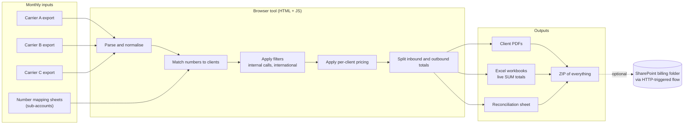
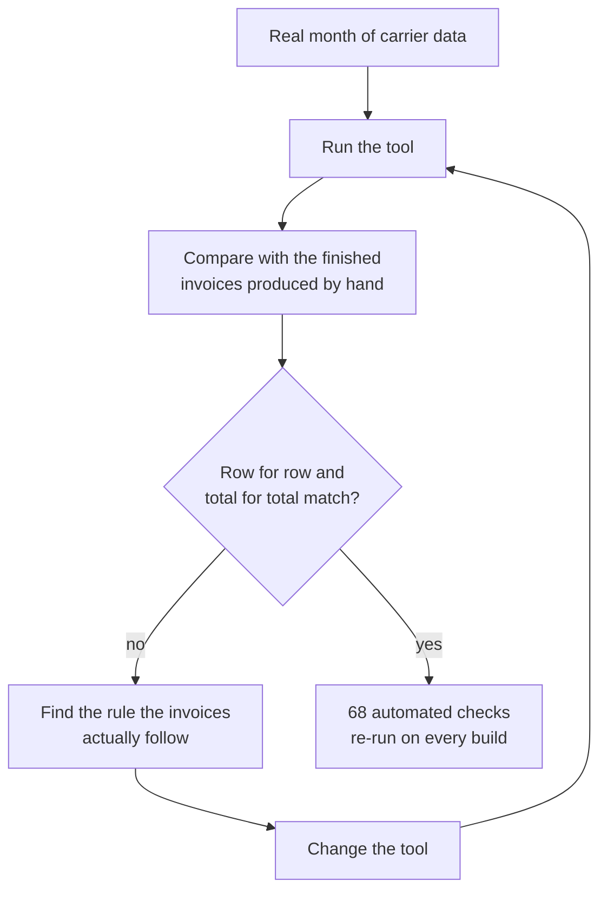

# Voice Billing CDR Processor

A single-file browser tool that turns monthly call detail record (CDR) exports from three different voice carriers into per-client billing outputs: call-record PDFs, Excel workbooks and a reconciliation sheet. It replaced an old single-carrier desktop tool and a set of manual spreadsheet steps.

> Case study. The production tool and data belong to my employer and are not published. This repository documents the design, architecture and decisions. All names and values shown are generic.

## What it does

## Pricing rules

Each client is a row in a pricing roster with:

- **Retail** tick box: pass calls through at carrier cost.
- Rate boxes when not retail: flat charge for 13/1300 numbers, multiplier for international, multiplier for local, mobile and national.
- **International calls**: include or drop, per client.
- **Internal calls** (same PBX, between handsets): include or exclude, per client.
- An "add a client" control, and a button that loads every client found in the month's data as a retail row.

Multipliers are applied per call, then totals are rounded the same way the invoices round them, so outputs match the invoice to the cent.

## How I validated it

The checks recompute every client, site and record type, include unit tests for the pricing functions and reconcile the split totals back to the raw input. Several rules only showed up this way, for example that the Excel output keeps every call type while the PDF outputs leave out internal calls.

## Problems worth mentioning

- **Corrupted numbers from a carrier.** One carrier exports through Excel, which turns long 1300 and 1800 numbers into scientific notation. Charges are unaffected but the digits are gone, so the fix has to come from the carrier.
- **Double-rendered PDFs.** One output stored a rendered PDF buffer that the save path rendered again, which corrupted the file. Storing the PDF spec instead fixed it.
- **Extra Excel columns.** The sheet writer only orders the header list and still appends other keys. Projecting rows to the exact column list fixed it.

## Documentation delivered

A user guide for the monthly process and a reference document listing every charge the tool applies, by carrier, generated straight from the pricing tables so reviewers can see the basis of each calculation.

## Stack

HTML, JavaScript, SheetJS (Excel), client-side PDF and ZIP libraries, Power Automate (HTTP trigger) and SharePoint for saving outputs.
